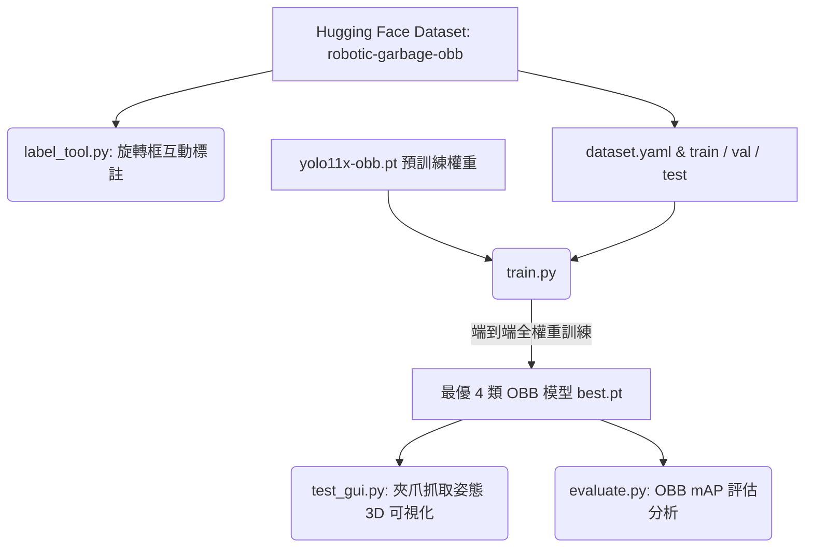

# garbage-yolo: AI Robotics Garbage Classification & Grasping (YOLOv11-OBB)


這是一個專為**機器手臂平行雙指夾爪 (Parallel Gripper)** 設計的 **YOLOv11-OBB (Oriented Bounding Box，旋轉邊界框)** 垃圾辨識與抓取姿態預測系統。

系統直接在機器人真實俯瞰視角（鳥瞰、純黑工作台桌面）上進行端到端訓練，輸出帶有**平面旋轉姿態角度 ($\text{Yaw}, \theta$)**、中心抓取點與長短軸的旋轉邊界框，提供機械手臂最即時且精準的抓取資訊。

專案資料集已全面託管於 Hugging Face：🤗 [**`0326BlueW/robotic-garbage-obb`**](https://huggingface.co/datasets/0326BlueW/robotic-garbage-obb)，並以 Git Submodule 形式無縫整合。

---

## 📊 獨立測試集評估指標 (Test Set Benchmark)

在 71 張完全獨立、未參與訓練的測試集（Held-out Test Set，共 531 個實例）上的評估表現：

| 指標 | 數值 | 說明 |
| :--- | :--- | :--- |
| **mAP@50** | **0.9562** | 主流 IoU 0.50 綜合指標 |
| **mAP@50-95** | **0.8514** | 嚴格多尺度綜合指標 |
| **Precision** | **0.9230** | 預測有垃圾時的準確率 |
| **Recall** | **0.9352** | 真實垃圾中被成功偵測的比例 |

### 各類別詳細指標 (Test Metrics)

| 類別名稱 (Class) | Precision | Recall | mAP@50 | 夾爪抓取特性 |
| :--- | :--- | :--- | :--- | :--- |
| `0: plastic` (塑膠容器) | 0.9231 | 0.9032 | 0.9160 | 寶特瓶、手搖杯等，沿長短軸對位閉合 |
| `1: metal` (金屬罐) | 0.9394 | 0.9669 | 0.9909 | 鋁罐、鐵罐，以柱狀對稱軸計算中心 |
| `2: paper` (立體紙容器) | 0.9258 | 0.9841 | 0.9882 | 具備高度與剛性（新鮮屋、紙碗、便當盒） |
| `3: general_waste` (一般垃圾) | 0.9036 | 0.8866 | 0.9295 | 衛生紙團、塑膠袋，以及**平鋪在桌面夾不起來的薄紙** |

> **平鋪紙張歸類為一般垃圾的物理考量**：
> 平行雙指夾爪在平坦桌面上無法直接夾取平鋪的薄紙張（缺乏高度與抓取縫隙）；且揉成團的廢紙屑與衛生紙在俯瞰視角下極具外觀紋理歧義。因此平鋪紙張被歸為 `general_waste`，將 `paper` 聚焦在夾爪可精準閉合的高價值立體容器。

---

## 專案工作流程 (Workflow)



---

## 快速開始 (Quickstart)

### 1. 複製專案與資料集 Submodule

```bash
# 包含資料集子模組一併下載
git clone --recurse-submodules <REPO_URL>
cd garbage-yolo

# 若已經 clone 但尚未拉取子模組：
git submodule update --init --recursive
```

### 2. 環境建置

```bash
python3 -m venv .venv
source .venv/bin/activate  # Windows: .venv\Scripts\activate
pip install -r requirements.txt
```

---

## 核心工具與操作說明

### 1. 圖形化推論與夾爪姿態測試 ([`test_gui.py`](test_gui.py))
即時預測 OBB 旋轉框，支援跨類別 Agnostic NMS 消除重複，並可視化展示夾爪抓取輔助線、3D 相機空間座標與可夾寬度（mm）。
```bash
python test_gui.py
```
- **資料夾切換**：下拉選單自動列出 `robotic-garbage-obb/` 下所有圖片資料夾（`test/images`、`val/images`、`demo/captures` 等）。
- **2×2 四格顯示**：原圖、OBB 標注、JET 深度圖、深度＋OBB 標注。
- **hover-to-inspect**：滑鼠移到偵測框即時顯示 3D 空間相機座標 (`pos`)、Yaw 抓取旋轉角 (`angle`) 與夾爪開合寬度 (`grip mm`)。

### 2. 端到端 OBB 訓練 ([`train.py`](train.py))
以 `yolo11x-obb.pt` 為基底進行全權重訓練，內建餘弦退火排程與旋轉資料增強：
```bash
python train.py --batch 16 --imgsz 1024 --epochs 300 --lr0 0.002
```

### 3. 模型評估與 mAP 分析 ([`evaluate.py`](evaluate.py))
在獨立測試集上計算 Precision, Recall, mAP@50 與 mAP@50-95：
```bash
python evaluate.py --split test
```

### 4. 旋轉框標註與檢查工具 ([`label_tool.py`](label_tool.py))
互動式 OBB 標註軟體，支援旋轉把手拖曳與微調：
```bash
python label_tool.py
```
- `[` / `]`：逆時針 / 順時針旋轉 2°（`{` / `}` 為 ±10°）。
- `0` ~ `3`：快速切換類別。
- `T` 鍵：在 `train`、`val`、`test` 資料集間切換。
- `A` / `D` / `Space`：上一張 / 下一張並自動存檔。
- 雙擊左鍵 / `Del`：刪除框。

### 5. AI 半自動預標註工具 ([`auto_label.py`](auto_label.py))
使用 `best.pt` 為未標註圖片自動生成初始 OBB 框：
```bash
python auto_label.py
```

### 6. RealSense 拍照採集工具 ([`capture_dataset.py`](capture_dataset.py))
一鍵儲存同一物理幀的 RGB 與對齊深度圖至 `robotic-garbage-obb/demo/captures/`：
```bash
source /opt/ros/humble/setup.bash
python3 capture_dataset.py --side left  # 或 right
```

---

## 授權聲明 (License)
- 本專案程式碼採用 [MIT License](LICENSE) 授權。
- 資料集採用 [CC BY 4.0](https://creativecommons.org/licenses/by/4.0/) 授權（詳見 Hugging Face [`robotic-garbage-obb`](https://huggingface.co/datasets/0326BlueW/robotic-garbage-obb)）。
